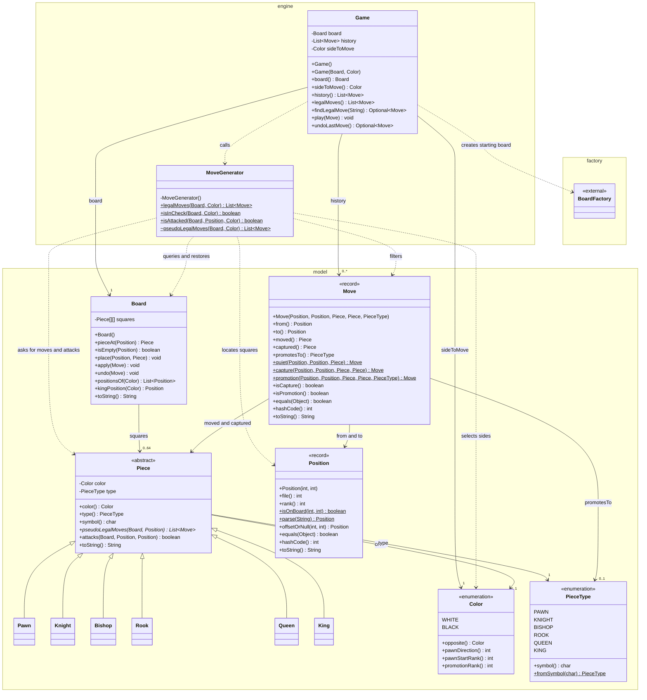
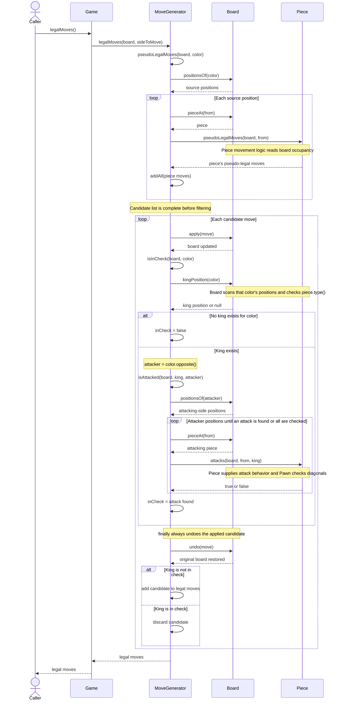

# M5 Engine and Model Design

## Class diagram

This diagram shows every class in the engine and model packages.
BoardFactory is included only as an external dependency of Game.

Public constructors and methods are listed. Parameter types are shown
without parameter names to keep the boxes narrower. The six concrete
piece subclasses omit their methods, as permitted by the assignment.
Record accessors and generated equality methods are included.
Standard inherited Object methods and generated enum methods are omitted.

### Relationship notes

- Solid arrows represent stored references. Dashed arrows represent
  dependencies used during operations.
- Hollow triangle arrows point from a subclass to its superclass.
- Game stores a Board reference, a list of Move references, and the
  current Color. It calls MoveGenerator but does not store one.
- Stored references are shown as associations rather than exclusive
  lifecycle ownership. Game can receive an existing Board, and Move
  records and Piece objects can be referenced elsewhere.
- MoveGenerator has no fields. Its operations are static and its
  constructor is private.
- The package-private pseudoLegalMoves method is included to show its
  restricted visibility.
- Each Move refers to one from position, one to position, and one moved
  piece. Its captured piece and promotion type may be null.
- Dependencies already evident from method signatures are not all
  repeated as arrows. For example, Piece reads Board and generates Move
  objects, while Board accepts Move objects in apply and undo.
- Board's existing promotion helper constructs Queen, Rook, Bishop, or
  Knight objects. These construction dependencies are described here
  rather than drawn as four additional crossing arrows. Board does not
  depend on PieceFactory.
- No BoardView or ReadOnlyBoard interface has been implemented.
- A trailing dollar sign marks a static method. A trailing asterisk marks
  an abstract method. The visibility markers are + for public, - for
  private, and ~ for package-private.

## Sequence diagram: game.legalMoves()

This diagram follows normal execution of the M5 implementation.
One Piece lifeline represents the different pieces consulted.
The caller's board is restored after each candidate.

If the check calculation throws an exception, the finally block still
calls Board.undo before the exception propagates. On normal execution,
the keep-or-drop decision happens after undo.

## Verification

- Maven: 61 tests run, 0 failures, 0 errors, 0 skipped.
- Game example: f2f3, e7e5, g2g4, d8h4.
- After those moves, game.legalMoves() returned an empty list.